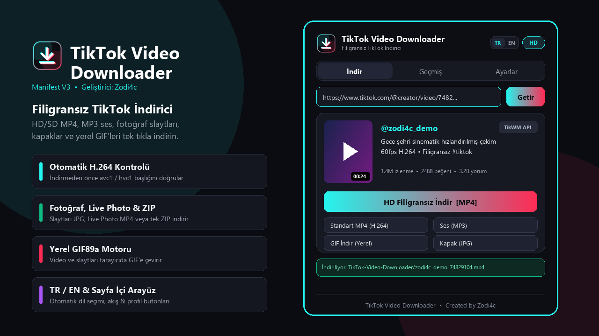
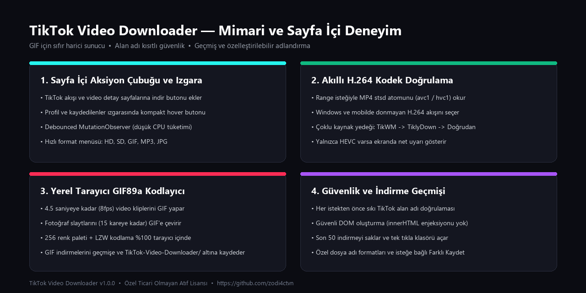
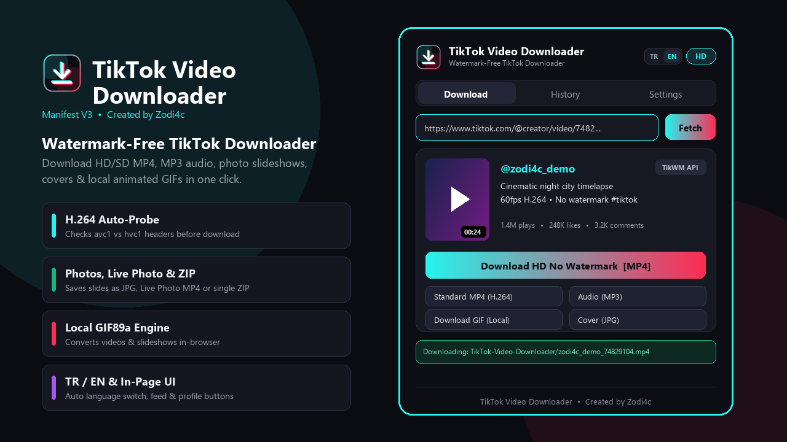
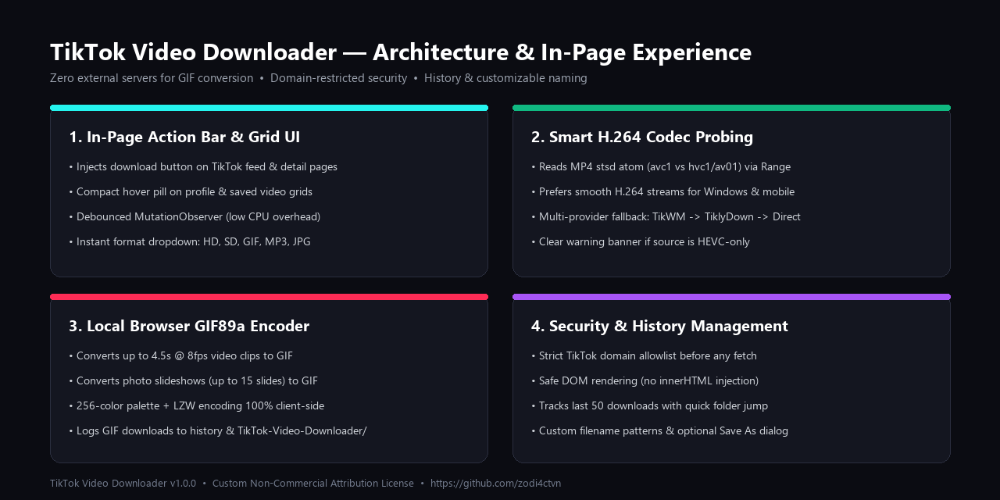

# TikTok Video Downloader — Watermark-Free TikTok Video, Audio, Photo & GIF Downloader

<div align="center">

**[🇹🇷 Türkçe](#-türkçe) · [🇬🇧 English](#-english)**

[](https://github.com/zodi4ctvn)


[](LICENSE)


**Chromium (Chrome, Edge, Brave, Opera) Manifest V3 extension for watermark-free TikTok MP4, MP3, photo slideshows, covers, and local GIF downloads.**  
**Created by [Zodi4c](https://github.com/zodi4ctvn).**

</div>

---

## 🇹🇷 Türkçe

<div align="center">



*TikTok Video Downloader — Açılır Pencere (Popup) Arayüzü ve Temel Özellikler*

<br/>



*TikTok Video Downloader — Kodek Doğrulama, Yerel GIF89a Motoru ve Güvenlik Mimarisi*

</div>

Chromium tabanlı tarayıcılar (**Chrome, Edge, Brave, Opera**) için geliştirilmiş; TikTok videolarını **filigransız** indirmenizi, **MP3 ses** ayıklamanızı, **fotoğraf slaytlarını / kapakları** kaydetmenizi ve videoları veya slaytları **hareketli GIF** olarak indirmenizi sağlayan Manifest V3 tarayıcı eklentisi.

### Özellikler

- **Filigransız MP4 İndirme:** Çoklu kaynak yapısıyla (`TikWM`, `TiklyDown` ve sayfa içi oturum çıkarımı) videoları filigransız olarak çözümler.
- **Otomatik H.264 Kodek Kontrolü:** İndirme öncesinde MP4 başlığını (`avc1` / `hvc1`) kontrol ederek Windows medya oynatıcılarında ve telefonlarda donmadan açılan **H.264** akışını önceliklendirir.
- **Fotoğraf, Slayt, Live Photo ve GIF Desteği:**
  - Düz fotoğrafları ve fotoğraf slaytlarındaki tüm görselleri `JPG` olarak veya **tek bir `.zip` dosyası** halinde indirir.
  - **Live Photo** gönderilerindeki hareketli video kliplerini (`MP4`) algılar ve indirir.
  - Video kapak fotoğrafını `JPG` olarak kaydeder.
  - Videoları veya fotoğraf slaytlarını harici bir sunucu kullanmadan doğrudan tarayıcıda hareketli `GIF` dosyasına dönüştürür ve geçmişe kaydeder.
- **Ses İndirme:** Videodaki müziği veya sesi `MP3` formatında indirir.
- **Sayfa İçi İndir Butonları:** Debounced `MutationObserver` ile TikTok akışına, video/fotoğraf detay sayfalarına ve profil/kaydedilenler ızgarasına düşük kaynak tüketimli indirme butonu ve format menüsü ekler.
- **İki Dilli Arayüz (TR / EN):** Tarayıcı diline göre otomatik Türkçe veya İngilizce açılır; popup üstünden tek tıkla dil değiştirilebilir.
- **Açılır Pencere (Popup) ve Akıllı Geçmiş:** Açık TikTok sekmesindeki video/fotoğrafı otomatik algılar, kısa linkleri (`vm.tiktok.com` / `vt.tiktok.com`) destekler, son 50 indirmeyi geçmişte tutar ve diskten silinen dosyaları **Silindi ×** olarak işaretler.
- **Güvenlik:** Tüm istekler öncesinde sıkı TikTok alan adı doğrulaması (`tiktok.com`, `vm.tiktok.com`, `vt.tiktok.com`, `m.tiktok.com`) uygulanır.

### Kurulum Rehberi

#### Seçenek 1: Hazır ZIP Paketi (Önerilen)
1. [Releases](https://github.com/zodi4ctvn/tiktok-video-downloader/releases/latest) sayfasından `tiktok-video-downloader-v1.0.0.zip` dosyasını indirip bir klasöre çıkarın.
2. Tarayıcınızda eklentiler sayfasını açın:
   - Chrome: `chrome://extensions`
   - Edge: `edge://extensions`
   - Brave: `brave://extensions`
   - Opera: `opera://extensions`
3. Sağ üst köşeden **Geliştirici modu (Developer mode)** seçeneğini açın.
4. **Paketlenmemiş öğe yükle (Load unpacked)** butonuna tıklayın ve çıkardığınız klasörü seçin.
5. `https://www.tiktok.com` adresine gidip sayfayı yenileyin (`F5`).

#### Seçenek 2: Kaynak Koddan (Git)
```bash
git clone https://github.com/zodi4ctvn/tiktok-video-downloader.git
```
Ardından yukarıdaki 2–5. adımları izleyip `tiktok-video-downloader` klasörünü seçin.

### Proje Dizini

```text
tiktok-video-downloader/
├── manifest.json       # Eklenti yapılandırması (Manifest V3)
├── background.js       # Arka plan servisi: medya çözümleme, kodek kontrolü, indirme ve geçmiş
├── content.js          # TikTok sayfa entegrasyonu, MutationObserver buton ekleme ve yedek çıkarım
├── content.css         # Sayfa içi buton ve bildirim stilleri
├── gif-encoder.js      # Video ve fotoğraf slaytları için tarayıcı içi GIF89a kodlayıcı
├── zip-builder.js      # Slayt ve Live Photo dosyalarını tek ZIP yapan bağımlılıksız paketleyici
├── popup.html          # Eklenti açılır pencere arayüzü
├── popup.css           # Koyu tema pencere stilleri
├── popup.js            # Önizleme, indirme, geçmiş ve ayarlar mantığı
├── assets/             # README tanıtım görselleri (TR ve EN showcase PNG'leri)
├── icons/              # Eklenti simgeleri (16x16, 48x48, 128x128)
├── LICENSE             # Custom Non-Commercial Attribution License
└── README.md           # Çift dilli dokümantasyon (TR / EN)
```

### Kullanılan İzinler

- `downloads`: Video, ses, fotoğraf ve GIF dosyalarını `İndirilenler/TikTok-Video-Downloader/` klasörüne kaydetmek için.
- `storage`: Varsayılan kalite, dosya adı formatı, buton görünürlüğü ve indirme geçmişini saklamak için.
- `activeTab`: Eklenti simgesine tıklandığında aktif TikTok sekmesindeki videoyu otomatik algılamak için.
- `host_permissions` (`*.tiktok.com`, `*.tikwm.com`, `api.tiklydown.eu.org`, `*.tiktokcdn.com`, `*.tiktokcdn-us.com`, `*.tiktokcdn-eu.com`, `*.muscdn.com`, `*.ibyteimg.com`, `*.byteimg.com`): Filigransız video, ses, fotoğraf ve Live Photo bağlantılarını almak ve MP4 kodek başlığını doğrulamak için.

### Sorun Giderme

- **Windows'ta video yerine sadece ses çalıyorsa:** Bazı TikTok videoları yalnızca `HEVC (H.265)` olarak yüklenmiştir ve H.264 sürümü bulunmaz. Eklenti bu durumda ekranda uyarı gösterir; bu tür dosyaları **VLC Media Player** ile açabilir veya Microsoft Store'dan **HEVC Video Uzantıları** paketini yükleyebilirsiniz.
- **Güncelleme sonrası butonlar görünmüyorsa:** `chrome://extensions` sayfasından eklentiyi **Yenile (Reload)** yapıp açık TikTok sekmelerini `F5` ile yenileyin.

### Yasal Uyarı

Bu proje yalnızca **kişisel ve eğitim amaçlı** kullanım içindir. Lütfen telif haklarına ve içerik üreticilerinin haklarına saygı gösterin; yalnızca indirme izniniz olan içerikleri kaydedin. Bu eklentinin TikTok veya ByteDance ile resmi bir bağlantısı yoktur.

### Geliştirici

**[Zodi4c](https://github.com/zodi4ctvn)** tarafından geliştirilmektedir.

### Lisans

[](LICENSE)

Bu proje **Özel Ticari Olmayan Atıf Lisansı (Custom Non-Commercial Attribution License)** ile lisanslanmıştır.

**Temel kısıtlamalar:**
- ✅ Kişisel ve eğitim amaçlı kullanım serbesttir
- ❌ Ticari kullanım **yasaktır**
- ❌ Zodi4c yazar bilgisini veya TikTok Video Downloader adını silmek / değiştirmek **yasaktır**
- ❌ Projeyi kendi projeniz olarak dağıtmak **yasaktır**
- ❌ Başka bir lisans altında yayımlamak **yasaktır**

Tam metin için [LICENSE](LICENSE) dosyasına bakınız.

---

## 🇬🇧 English

<div align="center">



*TikTok Video Downloader — Popup Interface & Core Highlights*

<br/>



*TikTok Video Downloader — Codec Probing, Local GIF89a Engine & Security Architecture*

</div>

A Manifest V3 browser extension for Chromium-based browsers (**Chrome, Edge, Brave, Opera**) that lets you download TikTok videos **without watermark**, extract **MP3 audio**, save **photo slideshows / covers**, and convert clips or slideshows into **animated GIFs**.

### Features

- **No Watermark MP4 Downloads:** Automatically resolves watermark-free streams with multi-provider fallback (`TikWM`, `TiklyDown`, and direct page/session extraction).
- **H.264 Compatibility Check:** Probes MP4 stream headers (`avc1` vs `hvc1`) before downloading to prefer H.264 streams that play smoothly in Windows Media Player, mobile devices, and video editors without freezing.
- **Photos, Slideshows, Live Photos & GIF Support:**
  - Download single photos and all slideshow images as `JPG`, or bundle them into a **single `.zip` archive**.
  - Detects and downloads animated **Live Photo** clips (`MP4`).
  - Download video covers (`JPG`).
  - Convert videos or photo slideshows into animated `GIF` files locally in the browser (no external server needed) and log them to download history.
- **Audio Extraction:** Save original sound / music as `MP3`.
- **In-Page Download Buttons:** Uses a debounced `MutationObserver` to inject lightweight download buttons onto TikTok's feed, video/photo detail pages, and profile/saved grids with a quick format dropdown.
- **Bilingual UI (TR / EN):** Auto-detects browser language (Turkish or English) and includes a one-click `TR | EN` switcher in the popup header.
- **Popup Interface & Smart History:** Auto-detects the active TikTok video/photo tab, supports manual link pasting (including short `vm.tiktok.com` / `vt.tiktok.com` links), keeps the last 50 downloads in history, and marks deleted files as **Deleted ×**.
- **Security:** Enforces a strict TikTok domain allowlist (`tiktok.com`, `vm.tiktok.com`, `vt.tiktok.com`, `m.tiktok.com`) before any credentialed fetch or third-party API request.

### Installation (Load Unpacked)

#### Option 1: Pre-packaged ZIP (Recommended)
1. Download `tiktok-video-downloader-v1.0.0.zip` from the [Releases](https://github.com/zodi4ctvn/tiktok-video-downloader/releases/latest) page and extract it to a folder.
2. Open your browser and navigate to:
   - Chrome: `chrome://extensions`
   - Edge: `edge://extensions`
   - Brave: `brave://extensions`
   - Opera: `opera://extensions`
3. Enable **Developer mode** (top-right toggle).
4. Click **Load unpacked** and select the extracted folder.
5. Visit `https://www.tiktok.com` and refresh the page (`F5`).

#### Option 2: From Source (Git)
```bash
git clone https://github.com/zodi4ctvn/tiktok-video-downloader.git
```
Then follow steps 2–5 above and select the `tiktok-video-downloader` folder.

### Project Structure

```text
tiktok-video-downloader/
├── manifest.json       # Extension manifest (Manifest V3)
├── background.js       # Service worker: media resolution, codec probing, downloads & history
├── content.js          # TikTok page integration, MutationObserver button injection & page extraction
├── content.css         # In-page button & toast notification styles
├── gif-encoder.js      # Client-side GIF89a encoder for videos & photo slideshows
├── zip-builder.js      # Zero-dependency STORE ZIP packager for slideshows & Live Photos
├── popup.html          # Extension popup UI
├── popup.css           # Dark theme popup styles
├── popup.js            # Preview, download, history & settings logic
├── assets/             # README showcase visuals (TR and EN showcase PNGs)
├── icons/              # Extension icons (16x16, 48x48, 128x128)
├── LICENSE             # Custom Non-Commercial Attribution License
└── README.md           # Bilingual documentation (TR / EN)
```

### Permissions Explained

- `downloads`: Saves videos, audio, photos, and GIFs to your `Downloads/TikTok-Video-Downloader/` folder.
- `storage`: Stores user preferences (default quality, filename format, button visibility) and local download history.
- `activeTab`: Detects the active TikTok video URL when opening the extension popup.
- `host_permissions` (`*.tiktok.com`, `*.tikwm.com`, `api.tiklydown.eu.org`, `*.tiktokcdn.com`, `*.tiktokcdn-us.com`, `*.tiktokcdn-eu.com`, `*.muscdn.com`, `*.ibyteimg.com`, `*.byteimg.com`): Required to resolve watermark-free video, audio, photo, and Live Photo URLs and probe MP4 codec headers.

### Troubleshooting

- **Only audio plays / black screen in Windows Media Player:** Some TikTok uploads only exist in `HEVC (H.265)` with no H.264 variant. The extension warns you when this happens; open those files with **VLC Media Player** or install the **HEVC Video Extensions** from the Microsoft Store.
- **Buttons do not appear after updating:** Reload the extension from `chrome://extensions` and press `F5` on open TikTok tabs.

### Legal Disclaimer

This project is intended for **personal and educational use only**. Please respect copyright laws and content creators' rights, and only download content you have permission to save. This extension is not affiliated with, endorsed by, or connected to TikTok or ByteDance.

### Author

Created and maintained by **[Zodi4c](https://github.com/zodi4ctvn)**.

### License

[](LICENSE)

This project is licensed under a **Custom Non-Commercial Attribution License**.

**Key restrictions:**
- ✅ Personal & educational use is allowed
- ❌ Commercial use is **prohibited**
- ❌ Removing or modifying the Zodi4c author credit or TikTok Video Downloader brand is **prohibited**
- ❌ Redistributing as your own project is **prohibited**
- ❌ Relicensing under any other license is **prohibited**

See the [LICENSE](LICENSE) file for full details.
